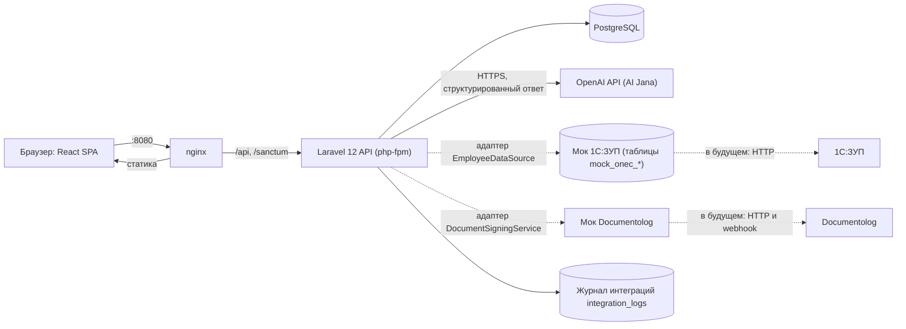

# JanaMen — единая цифровая HR-платформа

Прототип для хакатона Jana Post × Terricon Valley, Challenge 02 / Digital HR.
Сотрудник входит в одно пространство: видит профиль из кадровой системы, подаёт заявку на отпуск и следит за её статусом, проходит обучение и получает ответы HR-ассистента со ссылкой на источник. Руководитель и HR работают в том же интерфейсе, права определяются на бэкенде.

Все данные в проекте вымышленные, реальных персональных данных, паролей и токенов в репозитории нет.

## Быстрый старт

Нужны Docker и Docker Compose. При первом запуске нужен интернет (скачиваются образы, зависимости PHP и сборка фронтенда), первый старт занимает несколько минут.

```bash
cp backend/.env.example backend/.env
docker compose up -d --build
```

Дождитесь, пока контейнер `app` закончит миграции и загрузку демо-данных (`docker compose logs -f app`, строка `fpm is running`), и откройте **http://localhost:8080**.

На Windows проект лучше держать внутри WSL2, иначе Docker работает медленно.

Сбросить демо-данные в исходное состояние:
```bash
docker compose exec app php artisan demo:reset
```

## Тестовые учётки

Пароль у всех: `demo-password`.

| Email | Роль | Что показать |
|---|---|---|
| a.seitkali@janapost.demo | работник | подаёт заявку, курс «Добро пожаловать» в процессе, AI |
| d.zhumabaev@janapost.demo | работник | подтверждённый отпуск, завершённый курс |
| t.bekov@janapost.demo, a.kim@janapost.demo | работники | заявки в разных статусах |
| e.akhmetov@janapost.demo | руководитель | согласует заявки своей команды |
| director@janapost.demo | руководитель | согласует заявки руководителей, сам без руководителя |
| hr@janapost.demo, hr2@janapost.demo | HR | очередь заявок, подпись документов, назначение курсов |
| hr.head@janapost.demo | HR | руководитель HR-отдела: согласует заявки HR-специалиста как руководитель |

## Сквозные сценарии из ТЗ

1. **Вход и профиль.** `a.seitkali` входит и видит дашборд: профиль (данные из 1С, только чтение), остаток отпуска, заявки, курсы, уведомления.
2. **Заявка на отпуск.** Асель подаёт заявку → `e.akhmetov` согласует → `hr` одобряет (создаётся документ в Documentolog) → `hr` подтверждает подпись (приказ уходит в 1С, остаток отпуска у Асель уменьшается). На каждом шаге приходит уведомление, в карточке видна история.
3. **Ролевая модель.** Руководитель видит только свою команду и заявки её сотрудников; чужая заявка по прямой ссылке или запросом к API даёт `403`. HR не может согласовать собственную заявку, один человек не закрывает два шага одной заявки.
4. **Обучение.** Асель открывает курс «Добро пожаловать в Jana Post», проходит главу, сдаёт тест (порог 70%), прогресс обновляется. Руководитель и HR видят прогресс.
5. **AI Jana.** Вопрос «Сколько дней ежегодного отпуска мне положено?» → ответ и ссылка на раздел регламента.
6. **Честный отказ.** Вопрос вне базы знаний (например, про ипотеку) → «нет надёжной информации» и кнопка «Задать вопрос HR», которая создаёт обращение в очередь HR.

## Матрица доступа

| Данные | Работник | Руководитель | HR |
|---|---|---|---|
| Свой профиль | чтение | чтение | чтение |
| Профили других | нет | прямые подчинённые, урезанно | все |
| Заявки | свои | свои и подчинённых | все, действия по статусам |
| Обучение | свои курсы | прогресс подчинённых | назначение, прогресс всех |
| AI Jana и база знаний | общие документы | + документы для руководителей | + внутренний регламент HR |
| Кадровые данные 1С | только чтение | только чтение | только чтение |

Все ограничения проверяются на бэкенде (Gate и Policy), а не только скрываются в интерфейсе.

## Архитектура



- **Фронтенд:** Vite, React, TypeScript, Mantine, TanStack Query, react-i18next (ru, kz, en).
- **Бэкенд:** Laravel 12 (только API), Sanctum в режиме SPA (сессионная cookie и CSRF), Gate и Policy для прав, Laravel Notifications для уведомлений.
- **Заявки:** общий каркас (тип, автор, статус, jsonb-данные, история), переходы только через один сервис (state machine), событие смены статуса запускает уведомления и интеграции.
- **Интеграции:** «порты и адаптеры». Сейчас работают моки, место подключения реальных систем — интерфейсы `EmployeeDataSource` и `DocumentSigningService` (переключение `HR_SOURCE=mock|http`). Подробности подключения: [docs/implementation.md](docs/implementation.md).
- **AI Jana:** вся доступная роли база знаний передаётся в запрос, модель возвращает JSON (`found`, `answer`, `source_keys`), бэкенд проверяет, что все источники существуют и доступны роли; иначе показывается отказ. Данных сотрудников в запросе нет.

## AI Jana: ключ и безопасность

Ключ OpenAI в репозиторий не входит. Без ключа ассистент честно отвечает «временно недоступен» и предлагает обращение в HR, остальное работает. Чтобы включить AI, впишите ключ в `backend/.env`:
```env
OPENAI_API_KEY=ваш_ключ
OPENAI_MODEL=<id модели>
```
Затем `docker compose exec app php artisan config:clear`. Расход ограничен: 10 запросов в минуту на пользователя и суточный потолок (`AI_DAILY_LIMIT`).

## Проверки

```bash
./scripts/smoke.sh                                   # сквозные проверки по HTTP: роли, заявки, «два ключа», Academy, AI, интеграции
docker compose exec app php artisan test             # юнит-тесты защиты AI от выдуманных источников
./scripts/ai-eval.sh                                 # 15 контрольных вопросов AI Jana (нужен ключ)
```
`smoke.sh` пересоздаёт базу без демо-данных, после него для показа выполните `demo:reset`.

## Что реализовано, смоделировано и оставлено на развитие

Подробная таблица, ограничения и план подключения реальных систем: [docs/implementation.md](docs/implementation.md).

Коротко: реализованы авторизация и роли, профиль, заявка на отпуск с полной цепочкой согласования, уведомления, Jana Academy, AI Jana, журнал интеграций; смоделированы (моки) 1С:ЗУП и Documentolog; не делались электронная подпись, хранение оригиналов документов, рекрутинг и Performance Management.

## Структура репозитория

```
backend/    Laravel 12 API (app, database/seeders, routes)
frontend/   React SPA (Vite)
docker/     Dockerfile и конфиги nginx и php
docs/       api.md (контракт), db.md (схема), plan.md, implementation.md
scripts/    smoke.sh, ai-eval.sh, api.sh
```

## Принятые упрощения

- дни отпуска считаются календарными, праздники не исключаются;
- подпись документов моделируется: HR подтверждает кнопкой «Документы подписаны» (в продукте это сделает webhook Documentolog);
- данные 1С синхронизируются при старте контейнера и командой `onec:sync`, расписания нет;
- база знаний и курсы на русском; AI отвечает на языке запроса, перевод делает модель;
- в этой версии нет заявки «Аванс».