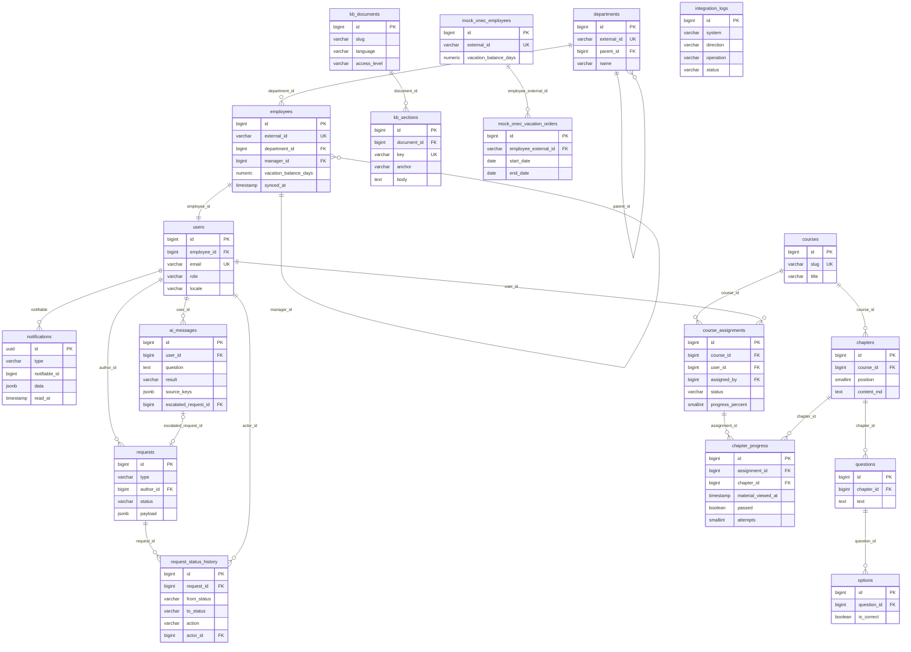

# JanaMen — схема базы данных

Схема для MVP по plan.md. СУБД: PostgreSQL. Миграции Laravel 12.

---

## 0. Общие соглашения

- Первичный ключ каждой таблицы: `id bigint` (автоинкремент). Исключение — `notifications`, там `uuid` (стандарт Laravel).
- `created_at`, `updated_at`: `timestamp(0)`, стандартные Laravel timestamps. Время хранится в UTC, в часовой пояс пользователя переводит фронт.
- Статусы, типы и роли хранятся строковыми кодами на английском (`varchar` + CHECK-ограничение или PHP enum в модели). Подписи на ru/kz/en переводит фронт.
- Внешние ключи по умолчанию `ON DELETE RESTRICT`. Каскадное удаление только для «вложенного» контента (главы курса, вопросы, варианты, разделы базы знаний).
- Заявки, история переходов, журнал интеграций и лог AI не удаляются, это аудит.
- Таблицы с префиксом `mock_` имитируют внешнюю систему 1С:ЗУП. При подключении реального API они исчезают, остальная схема не меняется.

---

## 1. ER-диаграмма

---

## 2. Справочник кодов (enum)

| Где | Поле | Значения |
|---|---|---|
| `users` | `role` | `employee`, `manager`, `hr` |
| `users` | `locale` | `ru`, `kz`, `en` |
| `requests` | `type` | `vacation`, `hr_question`, `advance` (если успеем) |
| `requests` (vacation, advance) | `status` | `pending_manager`, `pending_hr`, `awaiting_signature`, `approved`, `rejected`, `cancelled` |
| `requests` (hr_question) | `status` | `open`, `answered` |
| `request_status_history` | `action` | `create`, `manager_approve`, `manager_reject`, `hr_approve`, `hr_reject`, `sign`, `cancel`, `answer` |
| `course_assignments` | `status` | `not_started`, `in_progress`, `completed` |
| `kb_documents` | `access_level` | `all`, `manager`, `hr` |
| `kb_documents` | `language` | `ru`, `kz` |
| `ai_messages` | `result` | `answered`, `not_found`, `invalid_response`, `unavailable` |
| `integration_logs` | `system` | `onec_zup`, `documentolog` |
| `integration_logs` | `direction` | `inbound`, `outbound` |
| `integration_logs` | `status` | `success`, `error` |

---

## 3. Таблицы

### 3.1. Организация и пользователи

#### `departments` — подразделения (read-модель из 1С)

| Поле | Тип | Обяз. | Описание |
|---|---|---|---|
| id | bigint | да | PK |
| external_id | varchar(64) | да | id подразделения в 1С, UNIQUE |
| parent_id | bigint | нет | FK → departments.id, вышестоящее подразделение |
| name | varchar(255) | да | Название |
| source | varchar(32) | да | Откуда данные, по умолчанию `onec_zup` |
| synced_at | timestamp | да | Время последней синхронизации |
| created_at, updated_at | timestamp | да | |

#### `employees` — кадровые данные (read-модель из 1С, read-only в платформе)

| Поле | Тип | Обяз. | Описание |
|---|---|---|---|
| id | bigint | да | PK |
| external_id | varchar(64) | да | Табельный номер / id в 1С, UNIQUE |
| last_name | varchar(100) | да | Фамилия |
| first_name | varchar(100) | да | Имя |
| middle_name | varchar(100) | нет | Отчество |
| company | varchar(255) | да | Компания (юрлицо) |
| position | varchar(255) | да | Должность |
| department_id | bigint | да | FK → departments.id |
| manager_id | bigint | нет | FK → employees.id. Непосредственный руководитель. NULL — верх структуры (директор) |
| hired_at | date | да | Дата приёма |
| vacation_balance_days | numeric(5,2) | да | Остаток отпуска по данным 1С |
| source | varchar(32) | да | По умолчанию `onec_zup` |
| synced_at | timestamp | да | Время последней синхронизации |
| created_at, updated_at | timestamp | да | |

Индексы: `manager_id`, `department_id`.

Правило: пишет в эту таблицу только команда синхронизации с 1С. Через API платформы она только читается.

#### `users` — учётные записи платформы

| Поле | Тип | Обяз. | Описание |
|---|---|---|---|
| id | bigint | да | PK |
| employee_id | bigint | да | FK → employees.id, UNIQUE (связь 1:1). Каждый пользователь — работник |
| email | varchar(255) | да | Логин, UNIQUE |
| password | varchar(255) | да | Хэш пароля |
| role | varchar(16) | да | `employee` / `manager` / `hr`, по умолчанию `employee` |
| locale | varchar(2) | да | Язык интерфейса, по умолчанию `ru` |
| remember_token | varchar(100) | нет | Стандарт Laravel |
| created_at, updated_at | timestamp | да | |

Роль даёт права, связь `employees.manager_id` даёт область видимости. Шаг согласования руководителем определяется только связью: руководитель HR-отдела с ролью `hr` согласует заявки своих подчинённых как руководитель.

---

### 3.2. Заявки

#### `requests` — все заявки (общий каркас)

| Поле | Тип | Обяз. | Описание |
|---|---|---|---|
| id | bigint | да | PK, номер заявки в интерфейсе |
| type | varchar(32) | да | `vacation` / `hr_question` / `advance` |
| author_id | bigint | да | FK → users.id |
| status | varchar(32) | да | Текущий статус (см. справочник) |
| payload | jsonb | да | Данные, специфичные для типа (см. ниже) |
| created_at, updated_at | timestamp | да | |

Индексы: `(author_id, status)`, `(type, status)`.

Статус меняется только через сервис state machine, который в той же транзакции пишет строку в `request_status_history`.

**Содержимое `payload` по типам:**

| Тип | Поля |
|---|---|
| `vacation` | `vacation_type` (`annual_paid` / `unpaid`), `start_date`, `end_date`, `days` (календарные), `comment`, `document_ref` (id документа в Documentolog, заполняется при переходе в `awaiting_signature`) |
| `hr_question` | `topic` (`ai_escalation` / `profile_correction` / `other`), `question`, `ai_message_id` (если из AI), `answer`, `answered_by`, `answered_at` |
| `advance` | `amount`, `reason`, `comment` |

Если проверка пересечения дат по jsonb окажется неудобной, для отпуска можно добавить генерируемые колонки `start_date` / `end_date`. Для объёма демо-данных это не обязательно.

#### `request_status_history` — история переходов

| Поле | Тип | Обяз. | Описание |
|---|---|---|---|
| id | bigint | да | PK |
| request_id | bigint | да | FK → requests.id |
| from_status | varchar(32) | нет | NULL при создании |
| to_status | varchar(32) | да | |
| action | varchar(32) | да | Что сделано (см. справочник) |
| actor_id | bigint | да | FK → users.id, кто сделал |
| comment | text | нет | Обязателен при `manager_reject` и `hr_reject` (проверка в сервисе) |
| created_at | timestamp | да | Только время создания, строки не изменяются |

Индексы: `request_id`, `(request_id, actor_id)`.

Таблица одновременно служит таймлайном в карточке заявки и источником для правила «двух ключей» (см. раздел 4).

---

### 3.3. Уведомления

#### `notifications` — стандартная таблица Laravel Notifications

| Поле | Тип | Обяз. | Описание |
|---|---|---|---|
| id | uuid | да | PK |
| type | varchar(255) | да | Класс уведомления |
| notifiable_type | varchar(255) | да | Всегда модель User |
| notifiable_id | bigint | да | id получателя |
| data | jsonb | да | См. ниже |
| read_at | timestamp | нет | NULL — не прочитано |
| created_at, updated_at | timestamp | да | |

Индексы: `(notifiable_type, notifiable_id)`, частичный индекс по непрочитанным `(notifiable_id) WHERE read_at IS NULL` для быстрого счётчика при polling.

**Содержимое `data`:** `event` (код события, например `request_status_changed`), `message_key` (ключ i18n), `params` (параметры для перевода: номер заявки, название курса, новый статус), `link` (`entity_type` + `entity_id`, куда вести по клику).

---

### 3.4. Jana Academy

#### `courses`

| Поле | Тип | Обяз. | Описание |
|---|---|---|---|
| id | bigint | да | PK |
| slug | varchar(64) | да | UNIQUE, стабильный идентификатор для сидов |
| title | varchar(255) | да | |
| description | text | нет | |
| is_active | boolean | да | По умолчанию true |
| created_at, updated_at | timestamp | да | |

#### `chapters`

| Поле | Тип | Обяз. | Описание |
|---|---|---|---|
| id | bigint | да | PK |
| course_id | bigint | да | FK → courses.id, ON DELETE CASCADE |
| position | smallint | да | Порядок в курсе |
| title | varchar(255) | да | |
| content_md | text | да | Материал главы в Markdown |
| pass_threshold | smallint | да | Порог сдачи теста в процентах, по умолчанию 70 |
| created_at, updated_at | timestamp | да | |

UNIQUE `(course_id, position)`.

#### `questions`

| Поле | Тип | Обяз. | Описание |
|---|---|---|---|
| id | bigint | да | PK |
| chapter_id | bigint | да | FK → chapters.id, ON DELETE CASCADE |
| position | smallint | да | |
| text | text | да | Текст вопроса |

#### `options`

| Поле | Тип | Обяз. | Описание |
|---|---|---|---|
| id | bigint | да | PK |
| question_id | bigint | да | FK → questions.id, ON DELETE CASCADE |
| position | smallint | да | |
| text | varchar(500) | да | |
| is_correct | boolean | да | **Никогда не отдаётся на фронт** (скрыто в API Resource) |

В MVP один правильный вариант на вопрос.

#### `course_assignments` — назначение курса сотруднику

| Поле | Тип | Обяз. | Описание |
|---|---|---|---|
| id | bigint | да | PK |
| course_id | bigint | да | FK → courses.id |
| user_id | bigint | да | FK → users.id, кому назначен |
| assigned_by | bigint | да | FK → users.id, кто назначил (HR) |
| due_date | date | нет | Дедлайн |
| status | varchar(16) | да | `not_started` / `in_progress` / `completed` |
| progress_percent | smallint | да | 0–100, пересчитывается после каждого действия в главе |
| completed_at | timestamp | нет | |
| created_at, updated_at | timestamp | да | |

UNIQUE `(course_id, user_id)`. Индекс `user_id`.

Назначение на подразделение создаёт по строке на каждого сотрудника, отдельной таблицы нет.

#### `chapter_progress` — прогресс по главе

| Поле | Тип | Обяз. | Описание |
|---|---|---|---|
| id | bigint | да | PK |
| assignment_id | bigint | да | FK → course_assignments.id, ON DELETE CASCADE |
| chapter_id | bigint | да | FK → chapters.id |
| material_viewed_at | timestamp | нет | Нажата кнопка «Изучил» |
| last_score | smallint | нет | Правильных ответов в последней попытке |
| max_score | smallint | нет | Всего вопросов |
| passed | boolean | да | По умолчанию false. Однажды сданный тест не «отменяется» пересдачей |
| attempts | smallint | да | По умолчанию 0 |
| passed_at | timestamp | нет | |
| created_at, updated_at | timestamp | да | |

UNIQUE `(assignment_id, chapter_id)`.

Глава засчитана, если `material_viewed_at IS NOT NULL AND passed = true`. Прогресс курса = засчитанные главы / все главы курса.

---

### 3.5. База знаний и AI Jana

#### `kb_documents`

| Поле | Тип | Обяз. | Описание |
|---|---|---|---|
| id | bigint | да | PK |
| slug | varchar(64) | да | Стабильный идентификатор, например `vacation-policy` |
| language | varchar(2) | да | `ru` / `kz` |
| title | varchar(255) | да | |
| access_level | varchar(16) | да | `all` / `manager` / `hr` |
| position | smallint | да | Порядок в списке |
| created_at, updated_at | timestamp | да | |

UNIQUE `(slug, language)`.

#### `kb_sections`

| Поле | Тип | Обяз. | Описание |
|---|---|---|---|
| id | bigint | да | PK |
| document_id | bigint | да | FK → kb_documents.id, ON DELETE CASCADE |
| key | varchar(128) | да | UNIQUE. Стабильный id для промпта и ссылок, например `vacation-policy.duration`. Не меняется при пересоздании сидов, в отличие от числового id |
| anchor | varchar(64) | да | Якорь раздела на странице документа |
| title | varchar(255) | да | |
| body | text | да | Текст раздела (Markdown) |
| position | smallint | да | |

Обе таблицы заполняются сидером из Markdown-файлов репозитория.

#### `ai_messages` — лог вопросов к AI Jana

| Поле | Тип | Обяз. | Описание |
|---|---|---|---|
| id | bigint | да | PK |
| user_id | bigint | да | FK → users.id |
| locale | varchar(2) | да | Язык вопроса |
| question | text | да | |
| answer | text | нет | Показанный ответ (NULL при отказе) |
| result | varchar(32) | да | `answered` / `not_found` / `invalid_response` / `unavailable` |
| source_keys | jsonb | да | Массив `kb_sections.key`, прошедших проверку. Пустой при отказе |
| escalated_request_id | bigint | нет | FK → requests.id, если пользователь передал вопрос в HR |
| model | varchar(64) | нет | Какая модель отвечала |
| latency_ms | integer | нет | Время ответа |
| rating | smallint | нет | 👍 = 1 / 👎 = −1 (Could) |
| created_at | timestamp | да | |

Индексы: `user_id`, `result` (для раздела «вопросы без ответа»).

`invalid_response` — модель вернула `found = true`, но ссылки не прошли проверку на бэкенде. Полезно показывать на защите как работу защиты от выдумывания.

---

### 3.6. Интеграции

#### `integration_logs` — журнал интеграций

| Поле | Тип | Обяз. | Описание |
|---|---|---|---|
| id | bigint | да | PK |
| system | varchar(32) | да | `onec_zup` / `documentolog` |
| direction | varchar(8) | да | `inbound` / `outbound` |
| operation | varchar(64) | да | `sync_employees`, `send_vacation_order`, `create_signing_document` |
| entity_type | varchar(64) | нет | Например `request` |
| entity_id | bigint | нет | |
| status | varchar(16) | да | `success` / `error` |
| message | varchar(500) | да | Человекочитаемое описание для экрана HR |
| payload | jsonb | нет | Тело запроса/ответа (без персональных данных сверх необходимого) |
| created_at | timestamp | да | |

Индекс: `(system, created_at)`.

#### `mock_onec_employees` — «сторона 1С» (только для мока)

Хранилище мок-системы 1С:ЗУП. Заполняется из JSON-фикстур. Команда синхронизации читает отсюда через адаптер `EmployeeDataSource` и пишет в `departments` / `employees`.

| Поле | Тип | Обяз. | Описание |
|---|---|---|---|
| id | bigint | да | PK |
| external_id | varchar(64) | да | UNIQUE |
| data | jsonb | да | Карточка сотрудника в формате «как отдаёт 1С»: ФИО, должность, подразделение, руководитель, дата приёма |
| vacation_balance_days | numeric(5,2) | да | Остаток отпуска на стороне 1С |
| updated_at | timestamp | да | |

#### `mock_onec_vacation_orders` — принятые моком приказы об отпуске

| Поле | Тип | Обяз. | Описание |
|---|---|---|---|
| id | bigint | да | PK |
| employee_external_id | varchar(64) | да | FK → mock_onec_employees.external_id |
| request_id | bigint | да | id заявки в JanaMen (внешняя ссылка, без FK) |
| start_date | date | да | |
| end_date | date | да | |
| days | numeric(5,2) | да | |
| created_at | timestamp | да | |

При переходе заявки в `approved` адаптер создаёт приказ здесь, мок уменьшает `vacation_balance_days`, и следующая синхронизация (или немедленная пересинхронизация этого сотрудника) обновляет профиль.

---

## 4. Как правила плана ложатся на схему

| Правило | Как вычисляется |
|---|---|
| Доступный остаток отпуска | `employees.vacation_balance_days` − сумма `payload.days` по заявкам автора с `type = vacation` и `status` в `pending_manager`, `pending_hr`, `awaiting_signature` |
| Пересечение дат | Среди активных заявок отпуска автора нет такой, у которой период пересекается с новым |
| Подчинённые руководителя | `employees.manager_id` = `employee_id` текущего пользователя (только прямые подчинённые) |
| Кто согласует шаг руководителя | Пользователь, чей `employee_id` равен `manager_id` автора заявки |
| Нужен ли шаг руководителя | `manager_id` автора не NULL → `pending_manager`, иначе сразу `pending_hr` |
| Кто может сделать HR-шаг | `role = hr`, не автор, и его нет среди `actor_id` в `request_status_history` этой заявки с действиями `manager_approve` / `hr_approve` |
| Есть ли кому согласовать (при создании) | Существует хотя бы один пользователь с `role = hr`, который не автор и не руководитель-согласующий этой заявки |
| Очередь руководителя | Заявки со `status = pending_manager`, автор которых — его прямой подчинённый |
| Очередь HR | Заявки со `status` в `pending_hr`, `awaiting_signature` и `hr_question` в `open`, кроме собственных |
| Документы базы для AI | `access_level`: работник → `all`; руководитель → `all`, `manager`; HR → `all`, `manager`, `hr` |
| Проверка источников AI | Каждый ключ из ответа модели есть в `kb_sections.key` и принадлежит документу, доступному роли |
| Счётчик уведомлений | `notifications` получателя с `read_at IS NULL` (частичный индекс) |

---

## 5. Системные таблицы Laravel

- `migrations`;
- `sessions` — драйвер сессий `database`, нужен для Sanctum в SPA-режиме;
- `cache` и `cache_locks` — если драйвер кэша `database`;
- `personal_access_tokens` — только если придётся перейти на Bearer-токены (запасной план);
- `jobs`, `failed_jobs` — не нужны, очередей в MVP нет.

---

## 6. Сознательно не в MVP

- Отдельная таблица попыток теста с выбранными ответами (хранится только последний результат).
- Переводы контента курсов и названий подразделений (kz-версия базы знаний поддержана через `kb_documents.language`).
- Таблица «резервных согласующих».
- Хранение файлов документов на подпись (только `document_ref` в заявке).
- Векторные эмбеддинги для базы знаний.
